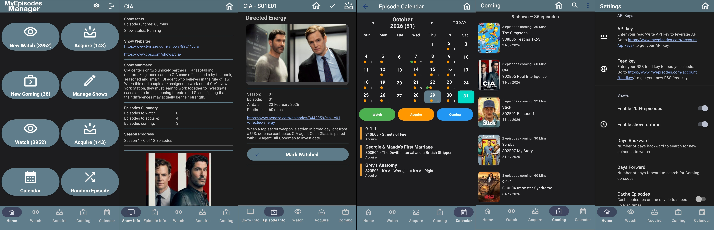

# MyEpisodes Manager

A native Android client for [MyEpisodes.com](https://www.myepisodes.com/) that keeps your TV watchlist with you on your phone.

**Platform:** Android 16+ (API 36) · **Language:** Java 17 · **License:** GNU GPL v3

---

## Overview

MyEpisodes Manager connects to your MyEpisodes.com account and turns your tracked shows into a fast, phone-friendly episode manager. It shows what you still need to watch, what you still need to acquire, and what is coming up, then lets you update your progress on MyEpisodes without opening the website.

Show and episode information is enriched with metadata from the [TVMaze API](https://www.tvmaze.com/api), including show summaries, cover images, runtimes, and useful links. Episode lists and metadata are cached locally so the app stays responsive and remains usable with a weak connection.

MyEpisodes Manager is an unofficial companion app. It is not affiliated with MyEpisodes.com or TVMaze.

---

## What it does

- Pulls your **Watch**, **Acquire**, and **Coming** episode lists from MyEpisodes.com.
- Groups episodes by show, with expandable rows and per-show episode counts.
- Lets you mark individual episodes, whole shows, or selected groups as watched or acquired.
- Keeps your MyEpisodes.com account in sync after every action.
- Shows a calendar of upcoming and recent episodes.
- Picks a random episode to watch, optionally filtered by runtime.
- Provides show landing pages with summaries, images, links, episode counts, and season progress.
- Provides episode details with air dates, summaries, links, and swipe navigation.
- Manages favourite and ignored shows, adds new shows by search, and edits show runtimes.
- Works around the MyEpisodes RSS feed 200-episode listing limit with configurable day ranges.
- Supports light, dark, and system themes, multiple languages, and local caching.

---

## Features

### Episode tracking

- **Watch list** – episodes you have not watched yet.
- **Acquire list** – episodes you still need to obtain.
- **Coming list** – future episodes for your tracked shows.
- Episodes are grouped by show in an expandable list.
- Mark a single episode or every episode in a show as watched or acquired.
- Long-press context menus for episode details, marking watched/acquired, and sharing.
- Share an episode to social media or any other app.
- Optional "only yesterday" mode for the Acquire list.
- Optional 200+ episode mode, with configurable days backward and forward.

### Show management

- View and manage **favourite shows** and **ignored shows**.
- Ignore, unignore, or delete a show from your MyEpisodes account.
- Search MyEpisodes.com and add new shows directly from the app.
- View and edit show runtimes.
- Detect missing or null runtimes and repair them from TVMaze.
- Open a show landing page with:
  - Show summary and cover image.
  - TVMaze and official website links.
  - Episode counts for Watch, Acquire, and Coming.
  - Season progress.
  - Quick navigation to the show's episode lists.

### Calendar

- Month-by-month episode calendar.
- Marks days that have episodes to watch, acquire, or coming up.
- Filter the calendar by Watch, Acquire, and Coming independently.
- Tap a day to see its episodes.
- Swipe or use the month/year picker to move through time.

### Random episode picker

- Recommends a random episode from your Watch list.
- Optional runtime filters: under 15, 30, 45, or 60 minutes, or over 60 minutes.
- Shows the episode's summary and artwork.
- Mark the recommended episode as watched without leaving the screen.

### Show and episode details

- Show summaries, images, status, runtime, and external links.
- Episode season, number, name, and formatted air date.
- Episode summaries and links where TVMaze has data.
- Mark watched or acquired from the detail screen.
- Swipe left/right to move between episodes of the same show.

### Sorting, searching, and filtering

- Choose show ordering for the Watch, Acquire, Coming, and Runtime lists: default, ascending, descending, by date, or runtime.
- Sort episodes oldest-first or newest-first.
- Toggle runtime sorting directly from the show listing toolbar.
- Search/filter the show listing by name.
- Configure MyEpisodes website filters:
  - List unacquired shows.
  - List unwatched shows.
  - List ignored shows.
  - List pilot shows.
  - List localized airdates.

### Caching and performance

- Optional local cache of episode lists.
- Configurable cache age, from 6 hours up to 1 month.
- Pull-to-refresh and manual refresh support.

### Personalisation

- System, light, or dark theme.
- Material 3 dynamic colours where supported.
- Language selection for supported locales:
  - Dutch, English, French, German, Hungarian, Italian, Latvian, Norwegian, Portuguese, Spanish, and Swedish.
- Optional password storage.

### Security and privacy

- All requests to MyEpisodes.com and TVMaze use HTTPS.
- Account passwords are never stored in plain text when password storage is enabled.
- Stored passwords are encrypted with AES-256-GCM using a key held in the Android Keystore.
- POST and AJAX requests use the CSRF token issued by MyEpisodes.com.
- No analytics, advertising, or third-party tracking SDKs are included.

---

## Getting started

1. Create an account at [MyEpisodes.com](https://www.myepisodes.com/) and add the shows you follow.
2. Install the app from a release APK in [`releases/`](releases/) or build it from source.
3. Log in with your MyEpisodes.com username and password.
4. Optionally open **Settings → API Keys** and add:
   - Your **API key** from <https://www.myepisodes.com/account/apikeys/>.
   - Your **RSS feed key** from <https://www.myepisodes.com/account/feedkey/>. The feed key is used to load your episode feeds.
5. Use **Manage Shows** to add, ignore, or remove shows, and to repair show runtimes.
6. Pull down or use the refresh button to update your lists.

> If episode lists fail to load, check that your RSS feed key is correct in **Settings → API Keys**.

---

## Screenshots
Overview of the key screens within the app

-  Home
-  Show Info
-  Episode Info
-  Calendar
-  Watch, Acquire, Coming
-  Settings

---

## Settings reference

| Group | Settings |
| --- | --- |
| **API Keys** | MyEpisodes API key, RSS feed key |
| **Shows** | Enable 200+ episodes, enable show runtime, days backward, days forward, cache episodes, cache file age, Acquire list mode (all / only yesterday) |
| **Disable** | Disable Acquire, disable Coming |
| **Order** | Watch/Acquire/Coming/Runtime show ordering, episode ordering (oldest or newest first) |
| **Website Filters** | Unacquired, unwatched, ignored, pilots, localized airdates |
| **Personalisation** | Theme, language, username, password, store password |
| **About** | Version, license, credits, website, email |
| **What's new** | Changelog |

---

## Troubleshooting

**Login fails**
- Confirm your MyEpisodes.com username and password.
- Check your internet connection and try again.
- If the problem persists, log in through the MyEpisodes.com website to confirm the account works.

**Episode lists are empty or stale**
- Pull to refresh or use the refresh button.
- Disable episode caching, or lower the cache age in Settings.
- Confirm the correct feed key is configured.

**Only 200 episodes are shown**
- Enable **200+ episodes** in Settings and adjust **Days Backward** and **Days Forward**.

**Show runtime or summary is missing**
- TVMaze may not have metadata for that show.
- Open **Manage Shows → Show Runtime** and use **Null Runtime Correction**.

**Episode feeds cannot be read**
- Confirm your internet connection and refresh the list.
- Add or re-enter the RSS feed key from <https://www.myepisodes.com/account/feedkey/> in **Settings → API Keys**.

---

## Contributing

Bug reports and pull requests are welcome at:

<https://github.com/mentalinc/my-episodes-watch-manager>

When reporting a bug, include:
- App version.
- Android version and device model.
- Steps to reproduce.
- Relevant logcat output, with any personal information removed.

---

## License

MyEpisodes Manager is released under the **GNU General Public License v3.0**.

See <https://www.gnu.org/licenses/gpl-3.0.html> for the full license text.

---

## Credits

- **Original idea:** Dirk Vranckaert
- **Programmed by:** mentalinc, Ivo Janssen, Dirk Vranckaert
- **Website:** <https://github.com/mentalinc/my-episodes-watch-manager>

Episode and show metadata is provided by [TVMaze](https://www.tvmaze.com/). Tracked-show data and account actions are provided by [MyEpisodes.com](https://www.myepisodes.com/).
